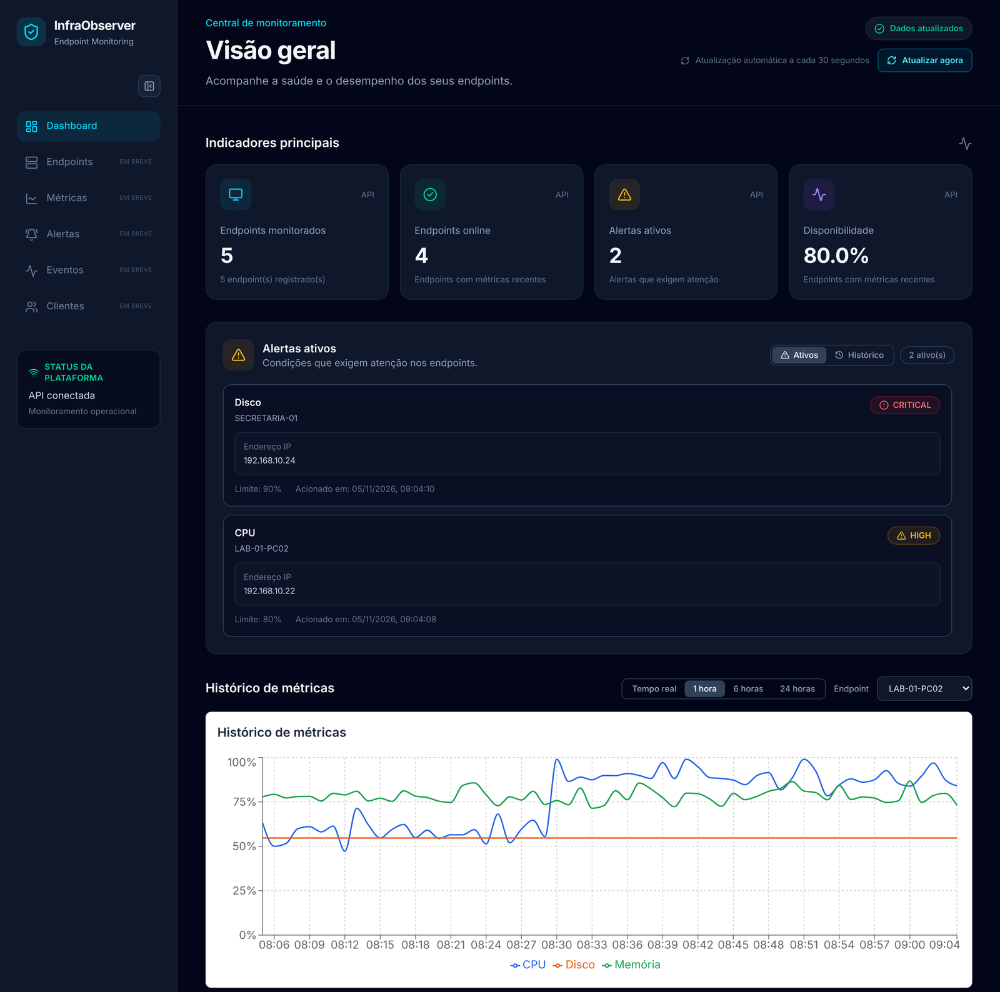
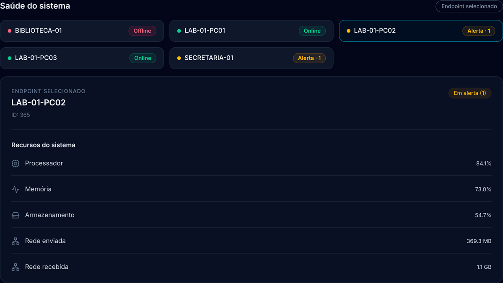
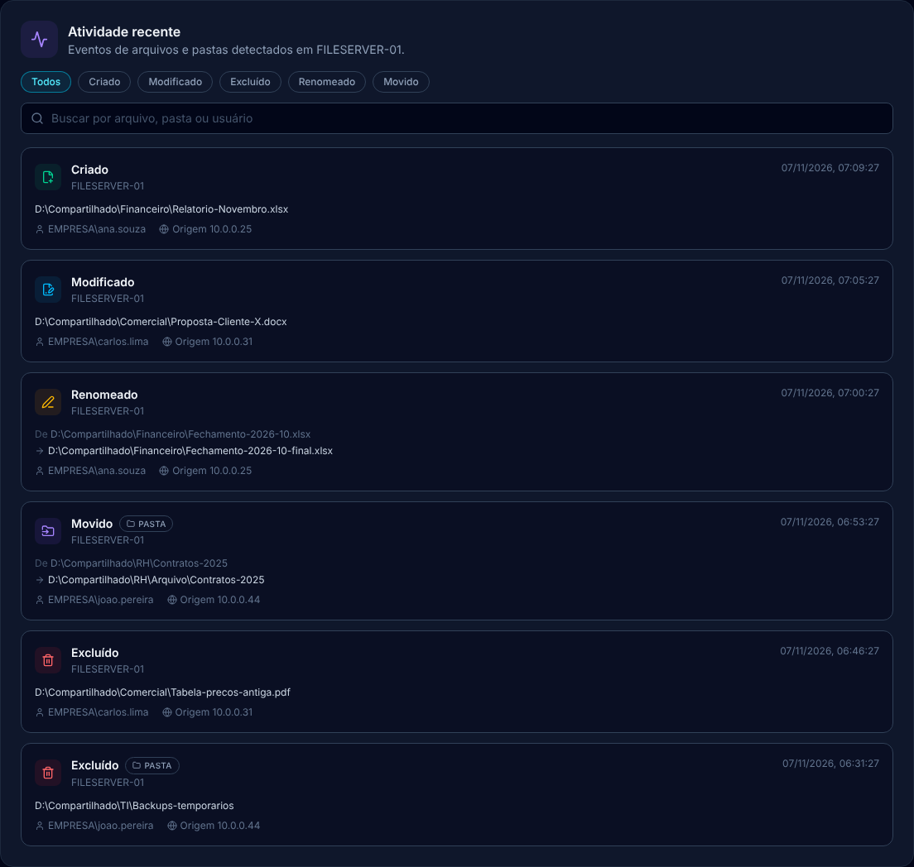
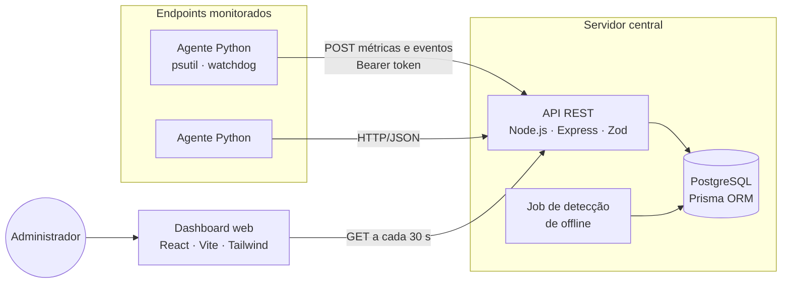

<div align="center">


# InfraObserver

**Monitoramento centralizado de endpoints em rede.**
Métricas de desempenho, alertas e eventos de sistema de arquivos de vários computadores em um único painel.

**[🌐 Acessar a aplicação: infraobserver.com.br](https://infraobserver.com.br)**

[](https://github.com/LocatelliBryann/InfraObserver/actions/workflows/ci.yml)
[](https://sonarcloud.io/summary/new_code?id=LocatelliBryann_InfraObserver)
[](https://sonarcloud.io/summary/new_code?id=LocatelliBryann_InfraObserver)
[](https://sonarcloud.io/summary/new_code?id=LocatelliBryann_InfraObserver)
[](https://sonarcloud.io/summary/new_code?id=LocatelliBryann_InfraObserver)


[Funcionalidades](#funcionalidades) ·
[Arquitetura](#arquitetura) ·
[Como executar](#como-executar) ·
[API](#api) ·
[Qualidade](#qualidade-e-testes) ·
[Documentação](#documentação)

</div>



## Sobre o projeto

Laboratórios de informática, instituições de ensino e pequenas empresas costumam descobrir problemas nos computadores só quando alguém reclama: a máquina lenta, o disco cheio, o computador que parou de responder. Ferramentas como Zabbix, Prometheus ou Datadog resolvem isso, mas exigem infraestrutura dedicada, conhecimento especializado ou licenças pagas.

O **InfraObserver** é uma alternativa leve e sem custo: um **agente** instalado em cada computador envia métricas e eventos para um **servidor central**, e um **dashboard web** mostra em tempo quase real o estado de todo o parque de máquinas.

> Projeto de Portfólio (TCC) do curso de Engenharia de Software da **Católica SC**.
> A proposta completa, com requisitos, casos de uso e decisões técnicas, está na [RFC](docs/RFC-InfraObserver.pdf).

## Funcionalidades

| Recurso | Descrição |
|---|---|
| 📊 **Métricas de desempenho** | CPU, memória, disco e rede de cada endpoint, coletadas em intervalo configurável |
| 📁 **Eventos de arquivos** | Criação, modificação, exclusão e renomeação em diretórios monitorados, com o usuário logado (auditoria básica) |
| 🚨 **Alertas automáticos** | CPU ou memória acima de 80% e disco acima de 90%; o alerta é resolvido após duas coletas normais seguidas |
| 📴 **Detecção de indisponibilidade** | Endpoint sem dados por 3 ciclos de coleta vira **offline** e gera alerta; ao voltar, é reativado sozinho |
| 🟢 **Status por endpoint** | Online, Alerta ou Offline, com a quantidade de alertas ativos |
| 📈 **Histórico** | Gráficos em tempo real ou dos últimos 1 h, 6 h e 24 h; histórico de alertas resolvidos com duração |
| 🔐 **Autenticação dos agentes** | Token Bearer por agente, validado em tempo constante |
| 🔁 **Agente resiliente** | Continua funcionando e tenta de novo se o servidor ficar fora do ar |

<details>
<summary><b>Mais telas</b></summary>

<br />

**Status dos endpoints e recursos do endpoint selecionado**



**Eventos de sistema de arquivos**



</details>

## Arquitetura

O sistema segue uma arquitetura **cliente-servidor com agentes em modelo push**: cada agente envia os dados ativamente ao servidor via HTTP/JSON, sem precisar abrir portas ou configurar firewall nos endpoints.



| Componente | Responsabilidade |
|---|---|
| **Agente** (`agent/`) | Coleta métricas com `psutil`, observa diretórios com `watchdog`, registra o endpoint e envia os dados ao servidor |
| **Backend** (`backend/`) | Valida e persiste os dados, avalia limites de alerta, detecta endpoints inativos e expõe a API REST. Organizado em camadas: *routes → controllers → services → repositories* |
| **Frontend** (`frontend/`) | Dashboard com indicadores, status por endpoint, gráficos de série temporal, alertas e eventos de arquivos |
| **Banco de dados** | PostgreSQL com quatro entidades: `Endpoint`, `Metric`, `FileEvent` e `Alert` |

Os diagramas C4 (contexto, containers e componentes) e o modelo de dados completos estão na seção 5 da [RFC](docs/RFC-InfraObserver.pdf).

### Stack

| Camada | Tecnologias |
|---|---|
| Agente | Python 3.12, psutil, watchdog, requests, pytest |
| Backend | Node.js 20, TypeScript, Express 5, Prisma 7, Zod, Vitest, Supertest |
| Frontend | React 19, TypeScript, Vite, Tailwind CSS 4, Recharts, Vitest, Testing Library |
| Banco de dados | PostgreSQL 16 |
| Qualidade e CI | GitHub Actions, SonarQube Cloud |
| Infraestrutura | Docker, Docker Compose, Caddy (HTTPS), Microsoft Azure |

## Como executar

### Pré-requisitos

- [Node.js](https://nodejs.org/) 20+
- [Python](https://www.python.org/) 3.12+
- [Docker](https://www.docker.com/) (para o PostgreSQL) ou um PostgreSQL 16 local

### 1. Banco de dados

```bash
docker compose -f infrastructure/docker/docker-compose.yml up -d
```

### 2. Backend

```bash
cd backend
cp .env.example .env          # ajuste AGENT_TOKENS
npm install
npx prisma migrate deploy
npm run dev                   # http://localhost:3000
```

### 3. Frontend

```bash
cd frontend
npm install
npm run dev                   # http://localhost:5173
```

Por padrão o dashboard consome a API em `http://localhost:3000`. Para outro endereço, defina `VITE_API_URL`.

### 4. Agente

Em cada computador que será monitorado:

```bash
cd agent
python -m venv .venv
.venv\Scripts\activate        # Windows  (Linux/macOS: source .venv/bin/activate)
pip install -r requirements.txt
cp .env.example .env          # configure servidor, token e diretórios
python -m src.main
```

<details>
<summary><b>Variáveis de ambiente</b></summary>

<br />

**Backend** (`backend/.env`)

| Variável | Descrição | Padrão |
|---|---|---|
| `DATABASE_URL` | Conexão com o PostgreSQL | — |
| `AGENT_TOKENS` | Tokens aceitos dos agentes, separados por vírgula | — |
| `AGENT_COLLECTION_INTERVAL_SECONDS` | Intervalo de coleta dos agentes | `60` |
| `OFFLINE_CHECK_INTERVAL_SECONDS` | Frequência da verificação de endpoints inativos | `60` |
| `PORT` | Porta da API | `3000` |

**Agente** (`agent/.env`)

| Variável | Descrição | Padrão |
|---|---|---|
| `INFRAOBSERVER_SERVER_URL` | Endereço do servidor central | — |
| `INFRAOBSERVER_AGENT_TOKEN` | Token do agente (deve estar em `AGENT_TOKENS`) | — |
| `INFRAOBSERVER_AGENT_ID` | UUID único do endpoint | — |
| `INFRAOBSERVER_COLLECTION_INTERVAL` | Intervalo de coleta, em segundos | `60` |
| `INFRAOBSERVER_MONITORED_DIRECTORIES` | Diretórios monitorados, separados por vírgula | — |

Para gerar um UUID: `python -c "import uuid; print(uuid.uuid4())"`

</details>

## API

| Método | Rota | Descrição | Autenticação |
|---|---|---|---|
| `POST` | `/api/v1/endpoints/register` | Registra ou atualiza um endpoint | Token do agente |
| `POST` | `/api/v1/metrics` | Envia uma coleta de métricas | Token do agente |
| `POST` | `/api/v1/file-events` | Envia um evento de sistema de arquivos | Token do agente |
| `GET` | `/api/v1/endpoints` | Lista os endpoints registrados | — |
| `GET` | `/api/v1/endpoints/health` | Status (online, alerta, offline) e última coleta de cada endpoint | — |
| `GET` | `/api/v1/metrics` | Histórico de métricas · `endpointId`, `from`, `to`, `limit` | — |
| `GET` | `/api/v1/file-events` | Eventos de arquivos · `endpointId`, `from`, `to`, `limit` | — |
| `GET` | `/api/v1/alerts` | Alertas · `status=active\|resolved\|all`, `endpointId`, `limit` | — |
| `GET` | `/health` | Verificação de saúde da API | — |

## Qualidade e testes

Todo push e pull request passa pelo pipeline de CI: testes dos três módulos com cobertura, build e análise estática no **SonarQube Cloud**, que comenta o resultado do Quality Gate em cada pull request.

| Módulo | Testes | Cobertura de linhas |
|---|---|---|
| Backend | 109 (unitários, de rota e de integração com PostgreSQL) | ~90% |
| Frontend | 61 (componentes, hooks e serviços) | ~85% |
| Agente | 59 | ~97% |

```bash
cd backend  && npm run test:coverage
cd frontend && npm run test:coverage
cd agent    && python -m pytest --cov=src
```

## Estrutura do repositório

```text
InfraObserver/
├── agent/                 # Agente Python (coletores, watchers, serviços HTTP)
├── backend/               # API REST (Express + Prisma)
│   ├── prisma/            # Schema e migrations
│   └── src/               # routes, controllers, services, repositories, jobs
├── frontend/              # Dashboard (React + Vite)
├── infrastructure/        # Docker Compose (dev e produção), cloud-init da Azure e Terraform
├── docs/                  # RFC, documento do projeto e imagens
└── .github/workflows/     # Pipelines de CI e de CD
```

## Roadmap

- [x] Agente com coleta de métricas, eventos de arquivos e resiliência a falhas de rede
- [x] API com autenticação dos agentes, alertas e detecção de endpoints offline
- [x] Dashboard com status por endpoint, histórico por período e histórico de alertas
- [x] CI com testes, cobertura e análise estática (SonarQube Cloud)
- [x] Deploy em nuvem (Microsoft Azure) com entrega contínua e domínio próprio
- [ ] Configuração remota dos agentes pelo dashboard
- [ ] Agente como serviço do Windows
- [ ] Telas de gerenciamento de endpoints e configurações

## Documentação

- [Wiki](https://github.com/LocatelliBryann/InfraObserver/wiki): instalação do agente, regras de alerta, decisões técnicas e problemas comuns
- [RFC do projeto (PDF)](docs/RFC-InfraObserver.pdf): visão do produto, requisitos, casos de uso, fluxos, arquitetura C4 e modelo de dados
- [RFC em Markdown](docs/rfc.md)
- [Guia de deploy em produção (Azure)](docs/deploy.md): arquitetura de produção, CD, rollback e operação
- [Documento do projeto](docs/Project.md)
- [Como contribuir](CONTRIBUTING.md)

## Autor

**Bryann Locatelli** · Engenharia de Software · Católica SC

[](https://github.com/LocatelliBryann)
<!-- Adicione o seu LinkedIn: [](https://www.linkedin.com/in/seu-perfil) -->

## Licença

Distribuído sob a licença MIT. Veja [LICENSE](LICENSE).
