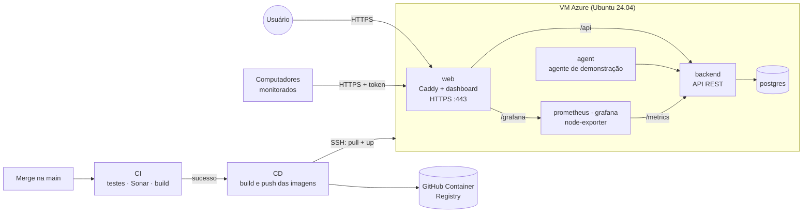

# Deploy em produção (Azure)

A aplicação está disponível em **https://infraobserver.com.br**.

Este guia descreve como o InfraObserver é publicado em produção: uma máquina virtual Linux na **Microsoft Azure** executando os containers com **Docker Compose**, atualizada automaticamente pelo **GitHub Actions** a cada merge na `main`.

## Arquitetura de produção



| Serviço | Imagem | Exposto na internet |
|---|---|---|
| `web` | `ghcr.io/locatellibryann/infraobserver-web` (Caddy + build do React) | Sim: portas 80 e 443 |
| `backend` | `ghcr.io/locatellibryann/infraobserver-backend` | Não: só pela rede interna, via Caddy |
| `postgres` | `postgres:16-alpine` | Não |
| `agent` | `ghcr.io/locatellibryann/infraobserver-agent` | Não |
| `prometheus` | `prom/prometheus` | Não |
| `node-exporter` | `prom/node-exporter` | Não |
| `grafana` | `grafana/grafana-oss` | Sim, pelo Caddy em `/grafana`, com login |

O monitoramento da própria aplicação está descrito em [observability.md](observability.md).

Decisões principais:

- **Caddy** como proxy reverso: emite e renova o certificado HTTPS (Let's Encrypt) sozinho e serve o dashboard e a API no mesmo domínio, sem precisar de CORS em produção.
- **Banco e API sem portas públicas**: só o Caddy recebe tráfego externo.
- **Migrations automáticas**: o container do backend executa `prisma migrate deploy` antes de iniciar.
- **Imagens versionadas pelo SHA do commit**: cada deploy é rastreável e pode ser revertido.
- **Agente de demonstração** rodando no próprio servidor, para o dashboard sempre ter dados.

## Ambientes

| Ambiente | Onde | Como sobe |
|---|---|---|
| Desenvolvimento | Máquina do desenvolvedor | `docker compose -f infrastructure/docker/docker-compose.yml up -d` + `npm run dev` (ver README) |
| Produção | VM na Azure | Automático, pelo workflow **CD** após o CI passar na `main` |

---

## 1. Criar a chave SSH do deploy

No seu computador (PowerShell), gere um par de chaves só para o deploy:

```powershell
ssh-keygen -t ed25519 -C "infraobserver-deploy" -f $HOME\.ssh\infraobserver_deploy
```

Deixe a senha da chave em branco (o GitHub Actions precisa usá-la sem interação). São criados dois arquivos:

- `infraobserver_deploy.pub`: chave **pública**, que vai para a Azure;
- `infraobserver_deploy`: chave **privada**, que vai para os secrets do GitHub. Nunca a compartilhe nem a versione.

## 2. Criar a máquina virtual

No [portal da Azure](https://portal.azure.com), vá em **Máquinas virtuais → Criar → Máquina virtual do Azure**:

**Aba Básico**

| Campo | Valor |
|---|---|
| Assinatura | Azure for Students |
| Grupo de recursos | Criar novo: `infraobserver-rg` |
| Nome da máquina virtual | `infraobserver-vm` |
| Região | **Chile Central**: a mais próxima do Brasil entre as permitidas pela assinatura de estudante |
| Imagem | **Ubuntu Server 24.04 LTS - x64 Gen2** |
| Tamanho | **Standard_B2als_v2** (2 vCPU, 4 GB de RAM). A aplicação usa cerca de 350 MB e o Grafana até 1 GB |
| Tipo de autenticação | **Chave pública SSH** |
| Nome de usuário | `azureuser` |
| Origem da chave pública SSH | **Usar chave pública existente**, colando o conteúdo de `infraobserver_deploy.pub` |
| Portas de entrada públicas | **HTTP (80), HTTPS (443) e SSH (22)** |

A assinatura Azure for Students só permite algumas regiões, e nem todos os tamanhos estão disponíveis em cada uma. As regiões liberadas aparecem em **Política → Atribuições → Allowed locations → Parâmetros**. Uma região fora da lista gera o erro `RequestDisallowedByAzure`. Escolha também **Opções de disponibilidade: Nenhuma redundância de infraestrutura necessária**.

**Aba Discos:** *SSD Standard* é suficiente.

**Aba Avançado → Dados personalizados:** cole o conteúdo de [`infrastructure/azure/cloud-init.yml`](../infrastructure/azure/cloud-init.yml). Ele instala o Docker, cria a pasta `~/infraobserver` e um swap de 2 GB. O arquivo não tem acentos de propósito, porque caracteres corrompidos na cópia fazem o cloud-init descartá-lo inteiro.

Clique em **Revisar + criar → Criar**.

## 3. Fixar o IP e criar o domínio

Depois que a VM for criada, abra o recurso **Endereço IP público** dela → **Configuração**:

1. **Atribuição:** mude para **Estático**, para o IP não mudar se a VM reiniciar.
2. **Rótulo do nome DNS:** por exemplo `infraobserver-bryann`.
3. **Salvar.**

O domínio público fica no formato:

```text
infraobserver-bryann.chilecentral.cloudapp.azure.com
```

> **Por que 4 GB:** a VM começou como Standard_B2ats_v2 (1 GB). Ela dava conta da aplicação, mas com o Prometheus e o Grafana a memória acabou, o sistema passou a usar o swap (565 MB em uso, 35 GB lidos do disco pelo Grafana) e tudo ficou lento. O redimensionamento é feito em **VM → Tamanho**, leva alguns minutos e mantém disco, IP e domínio.

## 4. Configurar o servidor

Conecte na VM:

```powershell
ssh -i $HOME\.ssh\infraobserver_deploy azureuser@infraobserver-bryann.chilecentral.cloudapp.azure.com
```

Confirme que o cloud-init terminou e que o Docker está instalado (se o Docker não aparecer, rode manualmente os comandos da seção `runcmd` do `cloud-init.yml`, com `sudo`):

```bash
cloud-init status --wait
docker --version
docker compose version
```

Crie o arquivo de configuração de produção a partir de [`infrastructure/docker/production.env.example`](../infrastructure/docker/production.env.example):

```bash
cd ~/infraobserver
nano .env
```

Gere os segredos direto na VM:

```bash
openssl rand -hex 32                  # para POSTGRES_PASSWORD e cada token de agente
cat /proc/sys/kernel/random/uuid      # para DEMO_AGENT_ID
```

Em `SITE_ADDRESS`, coloque o domínio do passo 3, **sem** `https://`. O `DEMO_AGENT_TOKEN` precisa estar na lista `AGENT_TOKENS`. Gere também o `JWT_SECRET` (`openssl rand -hex 32`), que assina as sessões do login. Defina também `GRAFANA_ADMIN_PASSWORD` (gerado com `openssl rand -hex 16`) e `GRAFANA_ROOT_URL` com o endereço público seguido de `/grafana/`; sem a senha, o deploy falha.

Proteja o arquivo:

```bash
chmod 600 .env
```

## 5. Configurar o GitHub

No repositório, vá em **Settings → Environments → New environment** e crie o ambiente **`production`**.

Em **Environment secrets**, adicione:

| Secret | Valor |
|---|---|
| `VM_HOST` | o domínio do passo 3 |
| `VM_USER` | `azureuser` |
| `VM_SSH_KEY` | o conteúdo **inteiro** do arquivo `infraobserver_deploy` (chave privada), incluindo as linhas `BEGIN` e `END` |

Em **Environment variables**, adicione:

| Variável | Valor |
|---|---|
| `PRODUCTION_URL` | `https://` + o domínio do passo 3 |

Opcional: em **Deployment protection rules**, marque **Required reviewers** para exigir uma aprovação antes de cada deploy.

## 6. Primeiro deploy

O workflow **CD** roda sozinho quando o **CI** termina com sucesso na `main`. Para o primeiro deploy:

1. Abra um pull request de `develop` para `main` e faça o merge.
2. Acompanhe em **Actions**: primeiro o **CI**, depois o **CD**, com os passos *Build* (três imagens), *Deploy em produção* e *Verificar se a aplicação respondeu*.
3. Acesse o `PRODUCTION_URL`. No primeiro acesso, o Caddy pode levar alguns segundos para emitir o certificado HTTPS.

Também é possível disparar manualmente em **Actions → CD → Run workflow**, na branch `main`.

**Criar o administrador do dashboard** (uma vez, depois do primeiro deploy com login):

```bash
cd ~/infraobserver
docker compose -f docker-compose.prod.yml exec backend \
  node dist/src/scripts/create-admin.js --email voce@exemplo.com --name "Seu Nome"
```

O comando pede a senha duas vezes, sem mostrá-la na tela (mínimo de 12 caracteres). Rodar de novo com o mesmo e-mail troca a senha.

## 7. Domínio próprio

O sistema também responde no domínio **infraobserver.com.br**, registrado no [Registro.br](https://registro.br).

**DNS** (no painel do Registro.br, em *Editar zona*):

| Tipo | Nome | Dados |
|---|---|---|
| A | *(raiz)* | IP público estático da VM |
| CNAME | `www` | `infraobserver.com.br.` |

**Servidor:** liste todos os endereços no `SITE_ADDRESS` do `.env`, separados por vírgula, e recrie o container do Caddy:

```bash
SITE_ADDRESS=infraobserver.com.br, www.infraobserver.com.br, infraobserver-bryann.chilecentral.cloudapp.azure.com
```

```bash
docker compose -f docker-compose.prod.yml up -d web
```

O Caddy emite um certificado HTTPS para cada endereço assim que o DNS estiver apontando para a VM. Confira com `nslookup infraobserver.com.br` antes de recriar o container. O endereço `cloudapp.azure.com` continua ativo para os links antigos e para o SSH do deploy (`VM_HOST`).

**GitHub:** atualize a variável `PRODUCTION_URL` do environment `production` para `https://infraobserver.com.br`.

## Operação

**Ver o estado e os logs**

```bash
cd ~/infraobserver
docker compose -f docker-compose.prod.yml ps
docker compose -f docker-compose.prod.yml logs -f backend
cat deploy-history.log                 # versões publicadas, com data
```

Métricas, painéis e alertas da aplicação ficam no Grafana, em `https://infraobserver.com.br/grafana/`. Veja [observability.md](observability.md).

**Rollback para uma versão anterior**

1. Pegue o SHA da versão boa em `deploy-history.log` ou no histórico do workflow CD.
2. Em **Actions → CD → Run workflow**, preencha **image_tag** com esse SHA.
3. O workflow pula o build e republica exatamente aquela versão.

**Conectar um computador real ao servidor**

1. Gere um token novo (`openssl rand -hex 32`) e acrescente-o em `AGENT_TOKENS` no `.env` da VM.
2. Aplique a mudança: `docker compose -f docker-compose.prod.yml up -d backend`.
3. No computador monitorado (Windows), rode o instalador da release e informe `https://<domínio>` e o token novo ([docs/agent-windows.md](agent-windows.md)). Pelo código-fonte, configure o `agent/.env` com os mesmos valores.

**Backup do banco**

```bash
docker compose -f docker-compose.prod.yml exec -T postgres \
  pg_dump -U infraobserver infraobserver > backup-$(date +%F).sql
```

## Segurança

- O `.env` de produção só existe na VM (`chmod 600`) e nunca é versionado.
- O PostgreSQL e a API não têm portas públicas; todo o tráfego externo passa pelo Caddy, com HTTPS.
- O acesso SSH é feito só por chave, sem senha.
- As imagens rodam com usuários sem privilégios de root (`node` no backend e `agent` no agente).
- O CD usa o token temporário do próprio GitHub Actions para baixar as imagens; nenhuma credencial do registry fica salva na VM.
