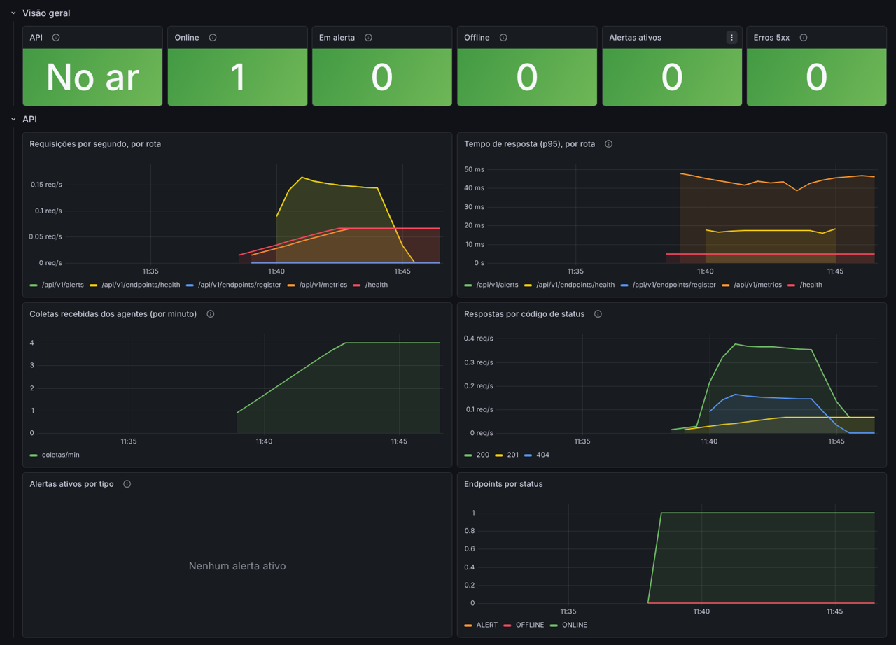
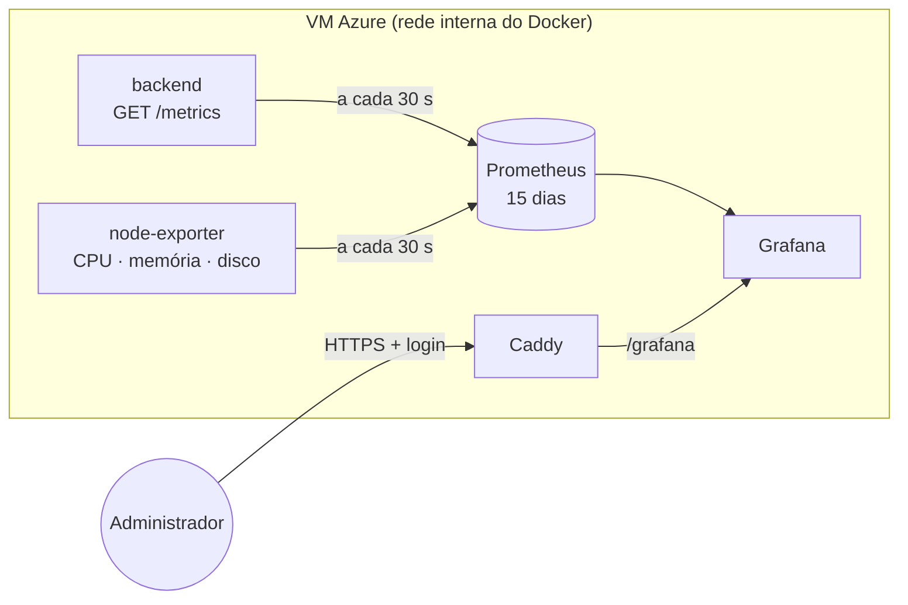

# Observabilidade

O InfraObserver monitora computadores, mas também precisa ser monitorado. Esta página descreve como a própria aplicação é acompanhada em produção: o que é medido, onde ver e o que gera alerta.



## Visão geral

| Pilar | Ferramenta | Onde ver |
|---|---|---|
| Métricas | Prometheus (coleta a cada 30 s, guarda 15 dias) | Grafana, dashboard **InfraObserver - Aplicação** |
| Logs | pino (JSON, uma linha por evento) | `docker compose logs` na VM |
| Alertas | Regras do Prometheus | Grafana, menu **Alerting → Alert rules** |
| Disponibilidade | `GET /health` | Teste do CD a cada deploy e healthcheck do Docker |



Prometheus, node-exporter e a rota `/metrics` do backend não têm porta pública. Só o Grafana é publicado, pelo Caddy, em `/grafana`, e exige login.

## Acessar o Grafana

1. Abra **https://infraobserver.com.br/grafana/**.
2. Entre com o usuário e a senha de `GRAFANA_ADMIN_USER` e `GRAFANA_ADMIN_PASSWORD`, definidos no `.env` da VM.
3. O dashboard **InfraObserver - Aplicação** abre como página inicial.

O dashboard e a conexão com o Prometheus vêm do repositório (`infrastructure/docker/monitoring/grafana`). Alterações feitas pela interface não são salvas: para mudar um painel, edite o JSON e faça um PR.

## O que é medido

### API (backend)

Expostas pelo backend em `GET /metrics` com a biblioteca [prom-client](https://github.com/siimon/prom-client).

| Métrica | Tipo | O que mostra |
|---|---|---|
| `http_requests_total{method, route, status_code}` | counter | Requisições recebidas, por rota e código de resposta |
| `http_request_duration_seconds{method, route, status_code}` | histogram | Tempo de resposta (usado para o p95) |
| `infraobserver_endpoints{status}` | gauge | Endpoints monitorados por status: `ONLINE`, `ALERT`, `OFFLINE` |
| `infraobserver_alerts_active{metric_type, severity}` | gauge | Alertas abertos no InfraObserver |
| `process_*`, `nodejs_*` | vários | Memória, CPU, event loop e garbage collector do Node.js |

O rótulo `route` usa o padrão da rota (`/api/v1/alerts/:id`), nunca a URL real, para não criar uma série nova a cada id. Rotas que não existem ficam agrupadas como `unmatched`.

As coletas dos agentes aparecem como `POST /api/v1/metrics` com status `201`. Um aumento de `401` nessa rota indica agente com token errado ou com acesso revogado (o log do backend registra `Revoked agent credential used`); `403` indica uma credencial usada para outro `agentId`.

### Servidor (VM)

O [node-exporter](https://github.com/prometheus/node_exporter) lê CPU, memória, swap, disco e rede da própria máquina virtual.

## Logs

O backend escreve logs em JSON com [pino](https://getpino.io). Cada requisição gera uma linha com método, URL, status e tempo de resposta, sem o cabeçalho `Authorization`:

```json
{"level":30,"time":"2026-11-06T14:32:49.837Z","service":"infraobserver-backend","req":{"method":"GET","url":"/api/v1/endpoints"},"res":{"statusCode":200},"responseTime":216,"msg":"request completed"}
```

| Nível | Quando |
|---|---|
| `info` (30) | Requisição com sucesso, API iniciada |
| `warn` (40) | Resposta 4xx, endpoint marcado como offline |
| `error` (50) | Resposta 5xx ou falha interna, com o stack do erro |

`/health` e `/metrics` não geram log, porque são chamadas o tempo todo. O nível é ajustado pela variável `LOG_LEVEL` (padrão `info`).

Na VM:

```bash
cd ~/infraobserver
docker compose -f docker-compose.prod.yml logs -f backend                  # acompanhar
docker compose -f docker-compose.prod.yml logs backend | grep '"level":50'  # só erros
```

Cada container guarda no máximo 3 arquivos de 10 MB de log, para não encher o disco.

## Alertas

As regras ficam em `infrastructure/docker/monitoring/prometheus/alerts.yml` e tratam da saúde da aplicação. Os alertas dos computadores monitorados (CPU, memória, disco, offline) continuam sendo gerados pelo próprio InfraObserver.

| Alerta | Condição | Severidade |
|---|---|---|
| `ApiFora` | O Prometheus não consegue ler a API por 2 minutos | critical |
| `TaxaDeErrosAlta` | Mais de 5% das respostas com erro 5xx por 5 minutos | warning |
| `RespostasLentas` | p95 do tempo de resposta acima de 1 s por 10 minutos | warning |
| `AgentesSemEnviarDados` | Nenhuma coleta de agente aceita em 10 minutos | warning |
| `MemoriaDoServidorAlta` | VM com mais de 90% de memória em uso por 10 minutos | warning |
| `DiscoDoServidorQuaseCheio` | Disco da VM acima de 85% por 10 minutos | critical |

Os alertas aparecem no Grafana em **Alerting → Alert rules**. O envio por e-mail está planejado junto com as notificações do sistema.

## Recursos na VM

A VM tem 4 GB de RAM (Standard_B2als_v2). Cada serviço de monitoramento tem um limite de memória, para que um problema nele não derrube a aplicação:

| Serviço | Limite | Uso medido em produção |
|---|---|---|
| Prometheus | 512 MB | ~15 a 40 MB |
| Grafana | 1 GB | ~460 MB |
| node-exporter | 64 MB | ~20 MB |

O Grafana roda sem plugins extras e com `GOMEMLIMIT` (700 MiB) para o garbage collector liberar memória antes de chegar ao limite. O Prometheus guarda 15 dias ou no máximo 1 GB, o que vier primeiro.

A primeira versão rodou numa VM de 1 GB. O Grafana 13 não coube junto com o resto: a VM passou a usar o swap e o painel ficou lento. Por isso a VM foi para 4 GB.

## Mudando a configuração

| O que mudar | Arquivo | Como entra em produção |
|---|---|---|
| Alvos do Prometheus | `monitoring/prometheus/prometheus.yml` | O CD copia e recarrega o Prometheus |
| Regras de alerta | `monitoring/prometheus/alerts.yml` | Igual ao anterior |
| Painéis | `monitoring/grafana/dashboards/infraobserver.json` | O Grafana relê a pasta a cada minuto |
| Senha do Grafana | Interface do Grafana (menu do usuário → **Change password**) | Na hora |

`GRAFANA_ADMIN_PASSWORD` só vale na primeira vez que o Grafana sobe, quando ele cria o próprio banco. Depois disso, mudar o `.env` não troca a senha.
