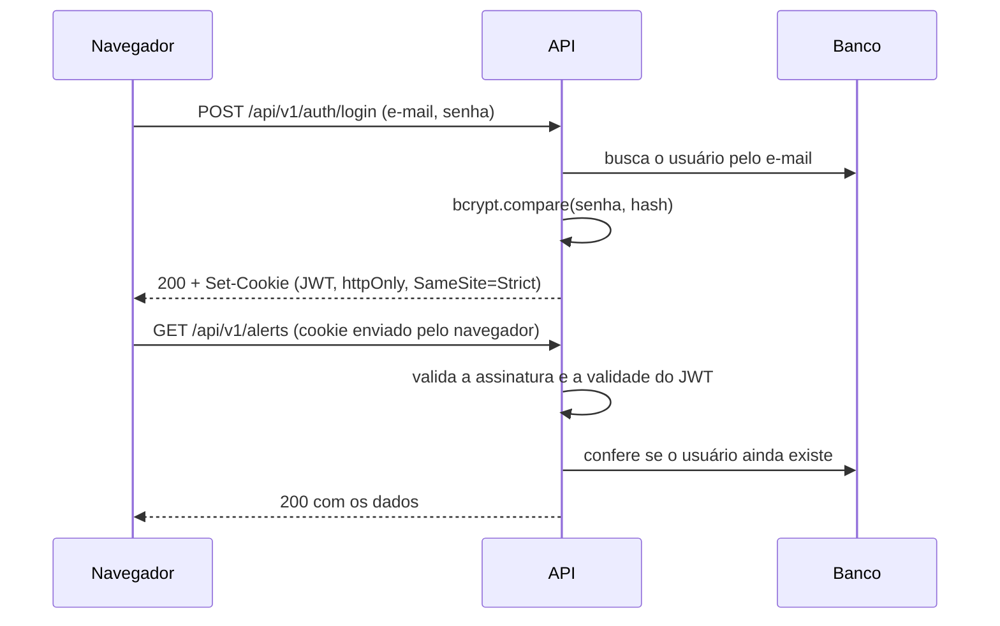
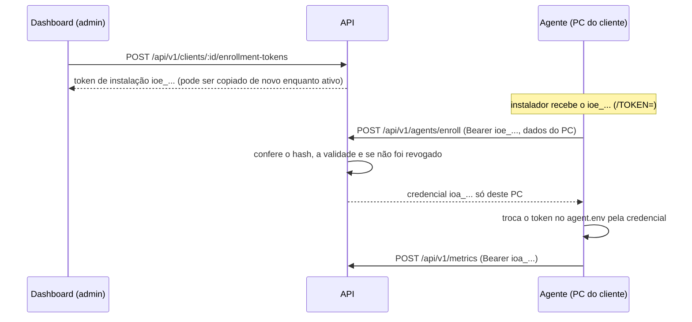

# Segurança

O dashboard e as consultas da API exigem login de administrador. Os agentes não fazem login: cada PC usa uma credencial própria (Bearer), recebida na instalação. Esta página descreve como cada parte é protegida.

## Quem acessa o quê

| Quem | Como se identifica | O que pode fazer |
|---|---|---|
| Administrador | E-mail e senha, depois um cookie de sessão | Ver o dashboard, consultar a API, cadastrar clientes, gerar e revogar tokens de instalação e revogar o acesso de um PC |
| Instalador do agente | Token de instalação do cliente (`ioe_...`) | Só trocar o token por uma credencial (`POST /api/v1/agents/enroll`) |
| Agente | Credencial própria do PC (`ioa_...`) ou, nos agentes antigos, um token da lista `AGENT_TOKENS` | Registrar o próprio endpoint e enviar métricas e eventos dele (`POST`) |
| Qualquer pessoa | Nada | Abrir a tela de login e o `/health` |
| Prometheus | Rede interna do Docker | Ler o `/metrics`, que não é publicado pelo Caddy |

## Login e sessão



| Item | Como funciona | Onde está |
|---|---|---|
| Senha | Guardada só como hash bcrypt (custo 12, ~250 ms por verificação). Mínimo de 12 caracteres | `services/auth.service.ts`, `utils/validation/auth.schema.ts` |
| E-mail inexistente | A senha é comparada com o hash de uma senha aleatória, gerado em memória, para a resposta levar o mesmo tempo e não revelar quais e-mails existem | `auth.service.ts`, `getDummyPasswordHash` |
| Sessão | JWT assinado com `JWT_SECRET` (HS256), com o id e o papel do usuário. Expira em 8 horas (`SESSION_HOURS`) | `auth.service.ts`, `config/auth.ts` |
| Cookie | `httpOnly` (o JavaScript da página não lê), `SameSite=Strict` e `Secure` em produção (só HTTPS) | `controllers/auth.controller.ts` |
| Validação da sessão | Assinatura, validade e existência do usuário a cada requisição. Usuário apagado perde o acesso na hora | `middlewares/require-auth.middleware.ts` |
| Derrubar todas as sessões | Trocar o `JWT_SECRET` no `.env` da VM e reiniciar o backend | — |

## Tokens dos agentes

Gerar um token na VM para cada computador não funciona com vários clientes. Por isso o agente entra em duas etapas:



| Item | Como funciona | Onde está |
|---|---|---|
| Geração | 32 bytes aleatórios (`crypto.randomBytes`) em base64url, com prefixo `ioe_` (instalação) ou `ioa_` (agente) | `security/agent-tokens.ts` |
| Armazenamento | O token é conferido pelo hash SHA-256. Para o administrador poder copiar de novo o token de instalação, ele também fica cifrado com AES-256-GCM, com uma chave derivada do `JWT_SECRET` por HKDF (chave separada da que assina as sessões). A lista mostra só o começo (`ioe_AbCdEfGh…`) | `services/client.service.ts`, `security/token-encryption.ts` |
| Copiar de novo | Botões **Copiar token** e **Copiar comando** na lista, só para tokens ativos. O valor é buscado no clique (`POST .../reveal`, com sessão, checagem de origem e `Cache-Control: no-store`), vai direto para a área de transferência e cada cópia fica no log com o usuário. Ao revogar, o valor cifrado é apagado. A credencial `ioa_` dos PCs nunca é guardada, só o hash | `controllers/client.controller.ts` |
| Trocar o `JWT_SECRET` | Os tokens continuam funcionando na instalação (o hash não muda), mas não podem mais ser copiados; o dashboard mostra "Não pode ser copiado" e é só gerar um token novo | `security/token-encryption.ts` |
| Token de instalação | Vale para vários PCs do mesmo cliente. Pode ter validade (7, 30 ou 90 dias) e ser revogado; revogar impede novas instalações, mas não derruba os PCs que já entraram | `services/agent-credential.service.ts` |
| Credencial do agente | Uma por PC. Só vale para o `agentId` daquele PC: usada com outro `agentId`, a resposta é 403. Nas rotas de configuração (`/api/v1/agents/:agentId/config`), vale o `agentId` da URL, mesmo que o corpo traga outro, para um PC não ler nem mudar as pastas de outro | `middlewares/agent-auth.middleware.ts` |
| Revogar um PC | "Revogar acesso" na saúde do endpoint ou na lista de PCs da página Clientes. A credencial passa a responder 401 (`Agent access revoked`) e o token compartilhado também é recusado para aquele PC. O histórico continua | `POST /api/v1/endpoints/:id/revoke` |
| Reinstalar | Instalar de novo com um token de instalação válido gera outra credencial e invalida a anterior (inclusive depois de uma revogação) | `agent-credential.service.ts`, `enroll` |
| Trocar de cliente | Um PC de um cliente não pode entrar com o token de outro (409) | `agent-credential.service.ts` |
| Agentes antigos | A lista `AGENT_TOKENS` continua valendo para PCs que ainda não têm credencial (e para o agente demo). Um PC que já recebeu credencial não pode voltar ao token compartilhado | `agent-auth.middleware.ts` |
| No agente | A credencial substitui o token no `agent.env`, trocando só aquela linha. O arquivo novo é escrito ao lado e trocado de uma vez, e a pasta só é lida por administradores e pelo sistema | `agent/src/config/credential_store.py` |

O SHA-256 basta para o hash porque o token é aleatório e longo: não há senha fraca para quebrar por dicionário, e a busca pelo hash é direta (bcrypt não permite buscar).

## Auditoria do Windows no agente

O agente instalado (serviço, conta LocalSystem) liga a auditoria de arquivos do Windows nas pastas monitoradas e lê o log de Segurança. Os cuidados:

| Item | Como funciona | Onde está |
|---|---|---|
| Comandos | `auditpol.exe` e `powershell.exe` chamados pelo caminho completo em `System32`, sem shell | `agent/src/audit/setup.py` |
| Pastas no PowerShell | Passadas por variável de ambiente (JSON) e lidas pelo script; nunca montadas no texto do comando, então um nome de pasta não vira comando | `setup.py`, `SACL_SCRIPT` |
| Script | Gravado na pasta do agente (`ProgramData\InfraObserver`), que só administradores e o sistema podem alterar | `setup.py` |
| Desfazer | O que o agente ligou fica em `audit-state.json`; a desinstalação tira só isso (uma auditoria que o administrador já tinha continua) | `setup.py`, `disable` |
| Leitura do log | Pela API do Windows (pywin32), só eventos 4663, 4660 e 5145 depois do último lido; contas de computador (`PC$`) são ignoradas | `agent/src/audit/event_log.py`, `events.py` |
| Privacidade | Só eventos das pastas monitoradas (onde está a regra); leituras não são auditadas. O agente envia usuário, programa e IP do evento, nada mais do log | `setup.py`, `enricher.py` |

## Retenção dos dados

Os dados de monitoramento não ficam para sempre: a RFC (RF23, RN06) define 60 dias.

| Item | Como funciona | Onde está |
|---|---|---|
| Prazo | `DATA_RETENTION_DAYS`, padrão `60`. `0` desliga a limpeza | `config/retention.ts` |
| Quando roda | Na partida da API e depois a cada 24 horas; duas limpezas nunca rodam ao mesmo tempo | `jobs/retention.job.ts` |
| O que sai | Métricas pela data da coleta; eventos de arquivo pela data em que o servidor recebeu (o relógio do PC pode estar errado); alertas resolvidos pela data em que dispararam | `repositories/retention.repository.ts` |
| O que fica | Alertas ainda abertos, mesmo antigos (descrevem o estado atual do PC), endpoints, clientes, tokens e usuários | `repositories/retention.repository.ts` |
| Registro | O log mostra quantos registros saíram de cada tabela e o Prometheus soma em `infraobserver_retention_deleted_total` | `jobs/retention.job.ts` |

No agente, a fila de envios guardada enquanto o servidor está fora do ar também tem limite: 7 dias ou 50 mil itens.

## Ataques considerados

| Ataque | Proteção |
|---|---|
| Força bruta na senha | 5 tentativas erradas por IP a cada 15 minutos; depois, resposta 429. Logins certos não contam (`middlewares/login-rate-limit.middleware.ts`) |
| Adivinhar um token de instalação | 256 bits aleatórios, e 20 tentativas erradas por IP a cada 15 minutos (`middlewares/enrollment-rate-limit.middleware.ts`). Instalações certas não contam, para vários PCs do mesmo escritório entrarem juntos: o erro só é contado depois que a resposta sai, então registros simultâneos não se bloqueiam (achado do teste de carga, ver [validacao.md](validacao.md)) |
| Token de instalação vazado | Revogar o token no dashboard; os PCs já instalados continuam com a credencial deles |
| PC roubado ou desligado da empresa | "Revogar acesso" no endpoint corta só aquele PC |
| Um agente se passar por outro | A credencial só vale para o próprio `agentId` (403 para os outros) |
| Token em log | O valor dos tokens nunca é registrado: o log guarda só o id e o começo (`ioe_AbCdEfGh`) |
| CSRF (outro site usando a sessão) | Cookie `SameSite=Strict`, CORS só para as origens liberadas e checagem da origem no login e no logout (`middlewares/same-origin.middleware.ts`) |
| XSS (roubo da sessão por script) | O cookie é `httpOnly`; o React escapa todo texto exibido; `helmet` envia os cabeçalhos de segurança |
| SQL injection | Prisma usa consultas parametrizadas; toda entrada passa por Zod |
| Senha em log | O logger registra só o e-mail das tentativas erradas e remove o cabeçalho `Authorization` |
| Token adulterado ou expirado | A assinatura e a validade são conferidas; a resposta é 401 e o dashboard volta para o login |

## Administração

Criar o administrador, ou trocar a senha de um existente:

```bash
# Desenvolvimento
cd backend && npm run create-admin -- --email voce@exemplo.com --name "Seu Nome"

# Produção (na VM)
docker compose -f docker-compose.prod.yml exec backend \
  node dist/src/scripts/create-admin.js --email voce@exemplo.com --name "Seu Nome"
```

A senha é pedida no terminal, sem aparecer na tela nem ficar no histórico do shell.

## Próximos passos

- **Multi-cliente:** a tabela de clientes, a ligação de cada PC com o cliente e o filtro `clientId` nas consultas já existem. Falta o papel `CLIENT` no usuário, para que cada cliente faça login e veja só os próprios PCs (o filtro passa a vir da sessão, e não da URL).
- **MFA (TOTP)** para o administrador.
