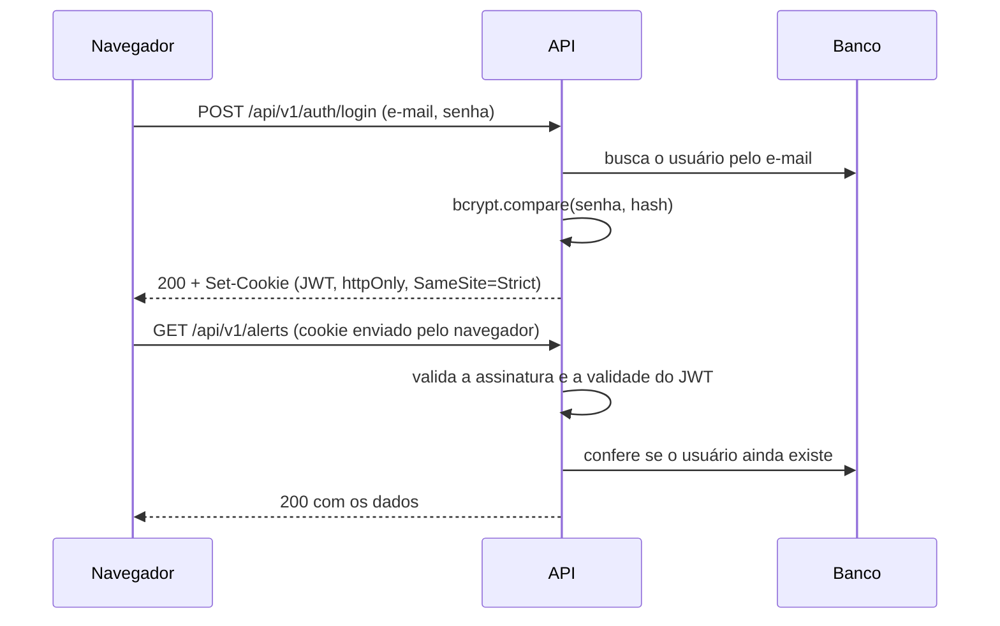

# Segurança

O dashboard e as consultas da API exigem login de administrador. Os agentes continuam usando o próprio token (Bearer), sem login. Esta página descreve como cada parte é protegida.

## Quem acessa o quê

| Quem | Como se identifica | O que pode fazer |
|---|---|---|
| Administrador | E-mail e senha, depois um cookie de sessão | Ver o dashboard e consultar a API (`GET`) |
| Agente | Token Bearer da lista `AGENT_TOKENS` | Registrar o endpoint e enviar métricas e eventos (`POST`) |
| Qualquer pessoa | Nada | Abrir a tela de login e o `/health` |
| Prometheus | Rede interna do Docker | Ler o `/metrics`, que não é publicado pelo Caddy |

## Login e sessão



| Item | Como funciona | Onde está |
|---|---|---|
| Senha | Guardada só como hash bcrypt (custo 12, ~250 ms por verificação). Mínimo de 12 caracteres | `services/auth.service.ts`, `utils/validation/auth.schema.ts` |
| E-mail inexistente | A senha é comparada com o hash de uma senha aleatória, gerado em memória, para a resposta levar o mesmo tempo e não revelar quais e-mails existem | `auth.service.ts`, `getDummyPasswordHash` |
| Sessão | JWT assinado com `JWT_SECRET` (HS256), com o id e o papel do usuário. Expira em 8 horas (`SESSION_HOURS`) | `auth.service.ts`, `config/auth.ts` |
| Cookie | `httpOnly` (o JavaScript da página não lê), `SameSite=Strict` e `Secure` em produção (só HTTPS) | `controllers/auth.controller.ts` |
| Validação da sessão | Assinatura, validade e existência do usuário a cada requisição. Usuário apagado perde o acesso na hora | `middlewares/require-auth.middleware.ts` |
| Derrubar todas as sessões | Trocar o `JWT_SECRET` no `.env` da VM e reiniciar o backend | — |

## Ataques considerados

| Ataque | Proteção |
|---|---|
| Força bruta na senha | 5 tentativas erradas por IP a cada 15 minutos; depois, resposta 429. Logins certos não contam (`middlewares/login-rate-limit.middleware.ts`) |
| CSRF (outro site usando a sessão) | Cookie `SameSite=Strict`, CORS só para as origens liberadas e checagem da origem no login e no logout (`middlewares/same-origin.middleware.ts`) |
| XSS (roubo da sessão por script) | O cookie é `httpOnly`; o React escapa todo texto exibido; `helmet` envia os cabeçalhos de segurança |
| SQL injection | Prisma usa consultas parametrizadas; toda entrada passa por Zod |
| Senha em log | O logger registra só o e-mail das tentativas erradas e remove o cabeçalho `Authorization` |
| Token adulterado ou expirado | A assinatura e a validade são conferidas; a resposta é 401 e o dashboard volta para o login |

## Administração

Criar o administrador, ou trocar a senha de um existente:

```bash
# Desenvolvimento
cd backend && npm run create-admin -- --email voce@exemplo.com --name "Seu Nome"

# Produção (na VM)
docker compose -f docker-compose.prod.yml exec backend \
  node dist/src/scripts/create-admin.js --email voce@exemplo.com --name "Seu Nome"
```

A senha é pedida no terminal, sem aparecer na tela nem ficar no histórico do shell.

## Próximos passos

- **Multi-cliente:** o usuário já tem um campo `role`. O próximo passo acrescenta o papel `CLIENT`, a tabela de clientes e o filtro por cliente nas consultas.
- **MFA (TOTP)** para o administrador.
